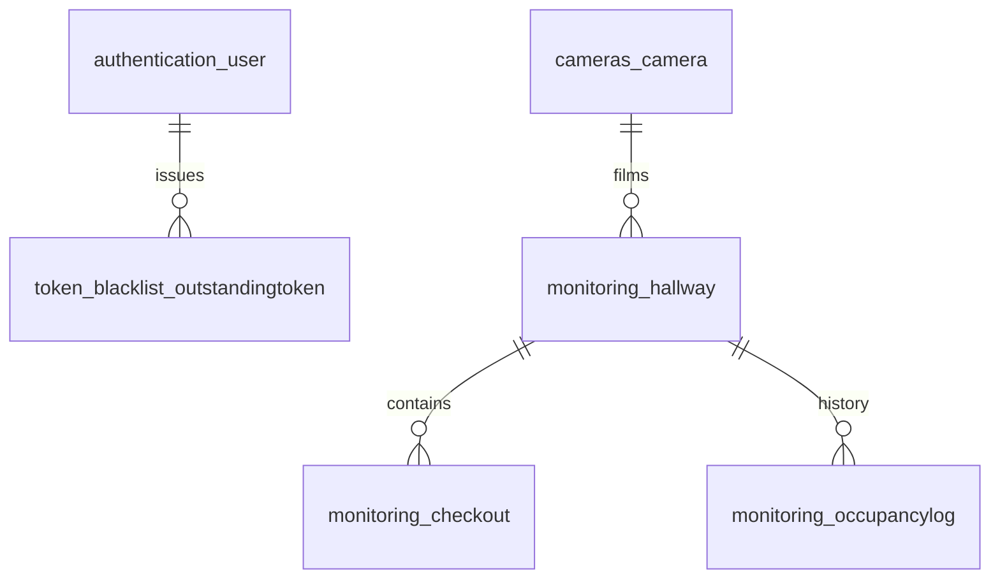

# SCHEMA_DATABASE.md

PostgreSQL 17 in production (SQLite when `POSTGRES_HOST` is unset, for local dev).
The source of truth is the Django migrations in `modules/*/migrations/`. This file explains them.

## authentication_user
Django `AbstractUser` plus a role.

| Column | Type | Notes |
|---|---|---|
| id | bigint PK | |
| username | varchar(150) UNIQUE | |
| password | varchar(128) | PBKDF2 hash (Django default) |
| role | varchar(20) | `admin` \| `operator`, default `operator` |
| is_superuser, is_staff, is_active | bool | superuser counts as admin |
| first_name, last_name, email, last_login, date_joined | | standard Django |

`admin` has full CRUD. `operator` is read-only (dashboard and streams).

## cameras_camera
| Column | Type | Notes |
|---|---|---|
| id | bigint PK | |
| name | varchar(100) | |
| ip_address | inet (`GenericIPAddressField`) | |
| rtsp_url | varchar(500) | `rtsp://` or `rtsps://`. Embedded credentials are **rejected** |
| username | varchar(100) | RTSP user |
| password_encrypted | text | Fernet (AES-128-CBC + HMAC), key = SHA-256(`FIELD_ENCRYPTION_KEY`). Never returned by the API |
| is_active | bool | inactive cameras are not processed |
| last_seen_at | timestamptz NULL | heartbeat from the vision service. `online` = seen within the last 15 s |
| created_at, updated_at | timestamptz | |

## monitoring_hallway
A queue zone on one camera image.

| Column | Type | Notes |
|---|---|---|
| id | bigint PK | |
| camera_id | FK → cameras_camera ON DELETE CASCADE | indexed |
| name | varchar(100) | |
| polygon | jsonb | `[[x, y], ...]`, ≥ 3 points, normalised 0–1 (resolution independent) |
| people_count | int ≥ 0 | live state, written by the vision service |
| updated_at | timestamptz | |

## monitoring_checkout
A checkout (caisse) inside a hallway. One hallway has 0..n checkouts.

| Column | Type | Notes |
|---|---|---|
| id | bigint PK | |
| hallway_id | FK → monitoring_hallway ON DELETE CASCADE | indexed |
| name | varchar(100) | |
| polygon | jsonb | customer side of the counter, same format as hallway |
| staff_polygon | jsonb NULL | cashier zone. People inside it are staff: never counted as waiting, never occupying a checkout |
| is_occupied | bool | live state: a tracked **customer**'s feet are inside `polygon` |
| is_open | bool | live state: someone is in `staff_polygon`, kept for 5 s after they leave. Always true when no cashier zone is mapped |
| updated_at | timestamptz | |

## monitoring_occupancylog
Append-only history for analytics. A row is written **only when a hallway's count or one of its checkouts changes**, not on every tick.

| Column | Type | Notes |
|---|---|---|
| id | bigint PK | |
| hallway_id | FK → monitoring_hallway ON DELETE CASCADE | |
| people_count | int | snapshot after the change |
| free_checkouts | int | snapshot after the change: checkouts that are open **and** not busy |
| created_at | timestamptz | |

Index: `(hallway_id, created_at DESC)` serves the cursor-paginated `/api/occupancy-logs/?hallway=` query.

## token_blacklist_outstandingtoken / token_blacklist_blacklistedtoken
Managed by `djangorestframework-simplejwt`. Rotated and logged-out refresh tokens are blacklisted. Run `python manage.py flushexpiredtokens` daily (cron) to prune expired rows.

## Write load and scaling notes
- Hot path: each camera pushes 1 metrics tick/s → 1 `UPDATE camera.last_seen_at` + only the changed hallway/checkout rows, in one transaction. 100 cameras ≈ 100 small writes/s, well within one Postgres.
- `occupancylog` is the only table that grows without bound. Once it passes ~100M rows, partition it by month (`PARTITION BY RANGE (created_at)`) and drop old partitions, or move it to TimescaleDB.
- Multi-store SaaS: add an `organization` table and an `organization_id` FK on `camera` and `user`, then scope every queryset by it. Not built yet (single site per deployment).
